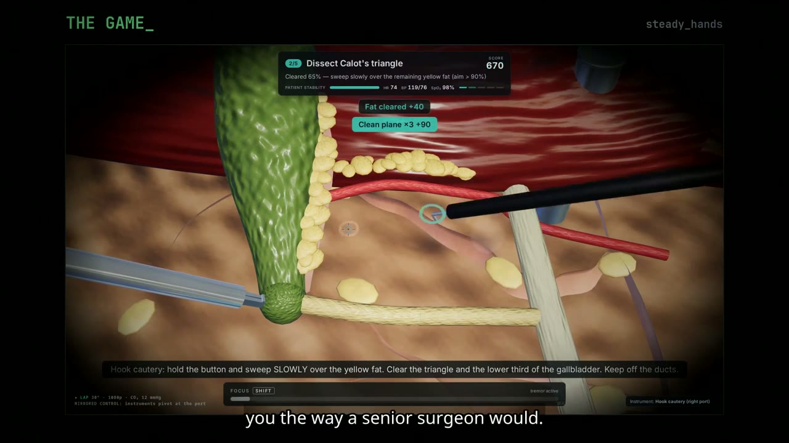
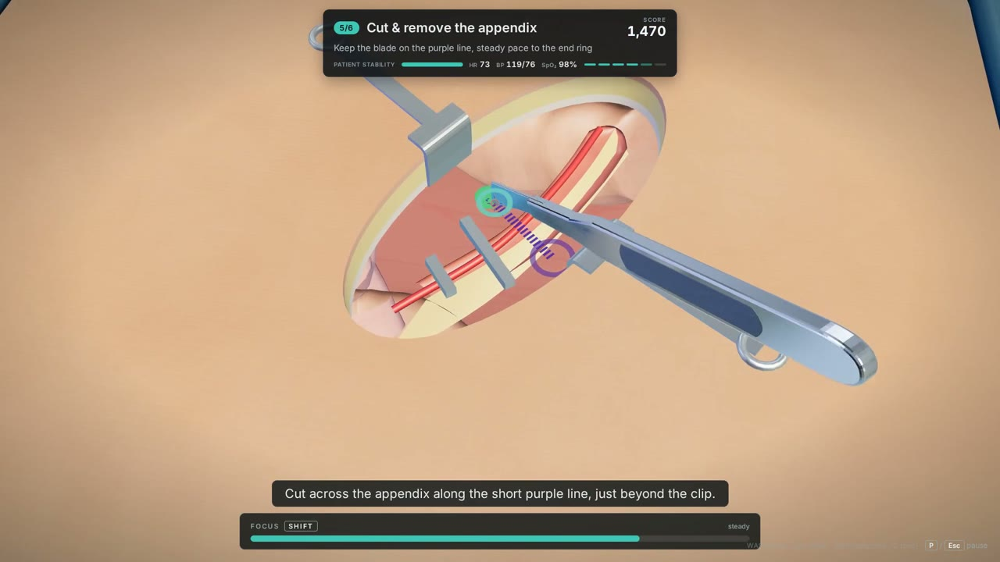
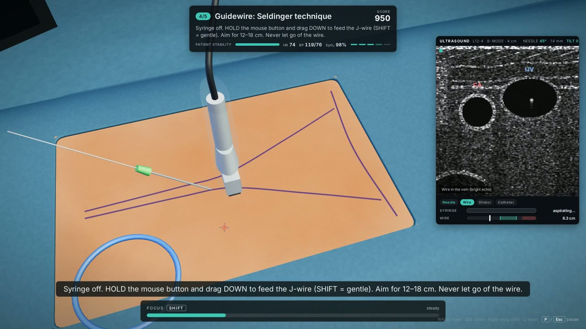
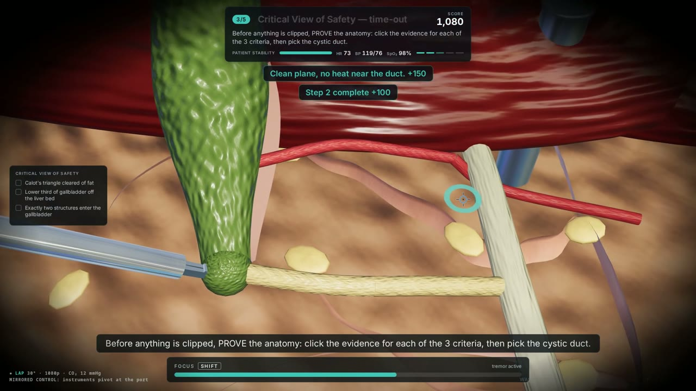
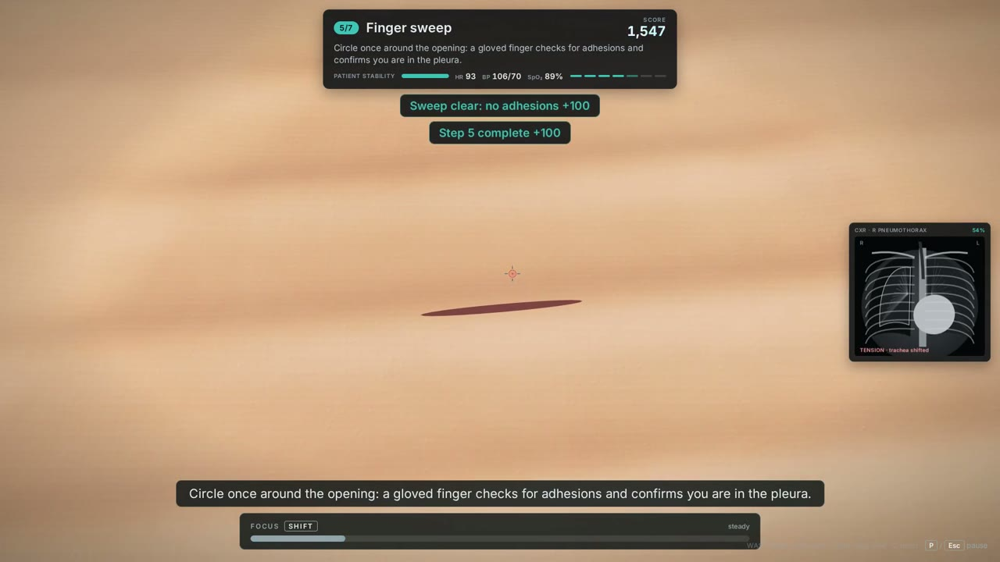
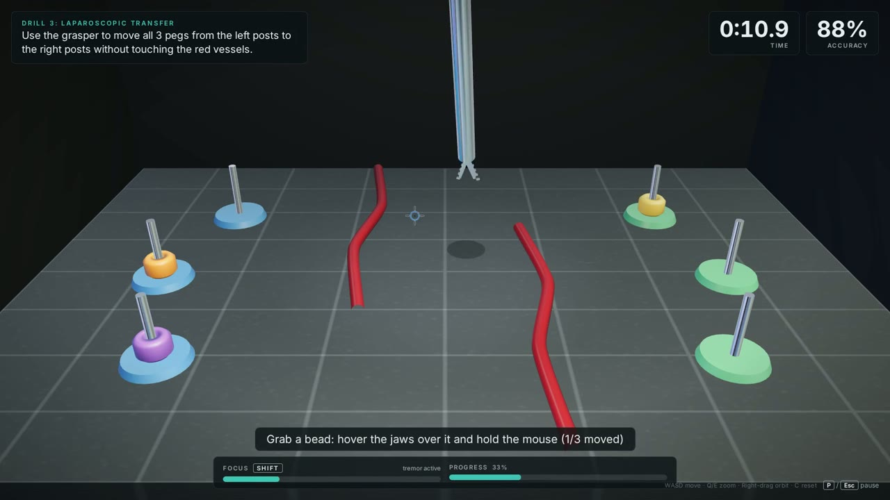
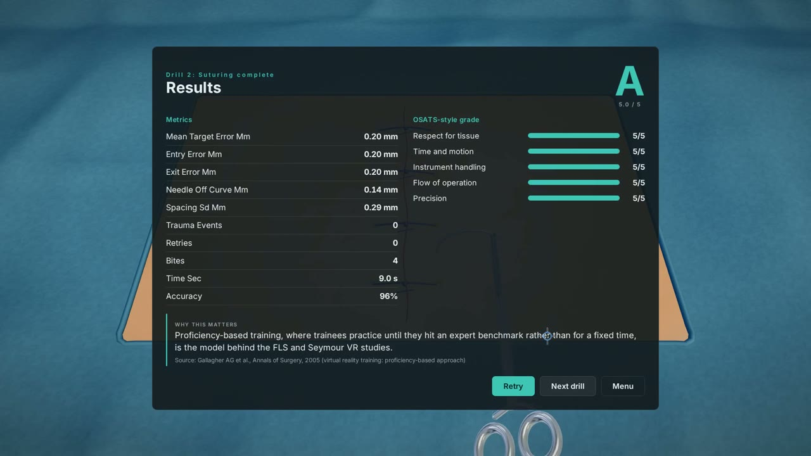

# Steady Hands

**Practice on pixels, not patients.** Steady Hands is a free, browser-based surgical skills trainer, built in one day for the High School I/O 2026 hackathon (Game Dev track, "Project Vital Quest").

Real surgical training happens in simulation labs most students never get to use. Steady Hands turns the skills those labs teach into game mechanics: hand tremor, the laparoscopic fulcrum effect, and grading modelled on OSATS (Objective Structured Assessment of Technical Skills). It runs on any laptop with nothing to install.

## Watch the 3-minute video
[](video/steady_hands_final.mp4)

▶ **[video/steady_hands_final.mp4](video/steady_hands_final.mp4)** (3:00, with subtitles). Click "View raw" on GitHub to play or download it.

## Screenshots
| | |
|---|---|
|  **Appendectomy:** cut and remove the appendix |  **Central line:** live ultrasound + Seldinger guidewire |
|  **Lap cholecystectomy:** prove the Critical View of Safety |  **Chest tube:** finger sweep, live chest X-ray |
|  **Laparoscopic transfer:** FLS peg transfer and the fulcrum effect |  **Results card:** OSATS-style grades + a sourced fact |

## What's in it

**3 drills**
| Drill | Skill |
|---|---|
| Precision Incision | Cut along a marked line at a steady depth |
| Suturing | Drive a curved needle through exact entry and exit points |
| Laparoscopic Transfer | FLS-style peg transfer through a pivoting port (the fulcrum effect) |

**5 procedures** (no gore, grounded realism, live vitals, coaching banner, combos)
| Procedure | Highlights |
|---|---|
| Appendectomy | Oblique incision, retraction, find the appendix without nicking its artery, clamp, cut, close |
| Laceration Repair | Clean, anaesthetise and close a forearm wound |
| Laparoscopic Cholecystectomy | Retract, dissect Calot's triangle, prove the Critical View of Safety, clip 2+1 on the duct and artery and cut. Picking the common bile duct stops you. |
| Central Line | Ultrasound-guided: the vein compresses and the artery pulses. Seldinger technique. |
| Chest Tube | Safe triangle, over the top of the rib, live intercostal cross-section and a chest X-ray where the lung re-expands |

**Plus:** a trivia quiz (26 sourced questions), OSATS-style results cards with a sourced fact after every run, and a free 3D camera.

## Run it

```bash
python3 -m http.server 8400
# open http://localhost:8400/
```
If the GPU loses the WebGL context (seen on some headless or NVIDIA setups), add `?safe=1` to the URL to turn shadows off.

**Controls:** move the mouse to aim, hold left click to act, hold **Shift** for a steady breath (less tremor, drains focus). Camera: **WASD** move, **Q/E** zoom, right-drag orbit, **C** reset. **P/Esc** pause.
- **Central line:** uses its own keys (A/D tilt the probe, scroll sets the needle angle).
- **Cholecystectomy:** **X** swaps between the clip applier and scissors.

## Tech stack
- **three.js 0.160** through an importmap, plain ES modules, no build step.
- **Procedural art:** every organ, instrument, drape and the patient are generated in code, and textures are painted on canvas. No downloaded models.
- **DOM/CSS HUD** with the Inter font.
- **JSON content** (`content/`): drills, OSATS rubric, facts, trivia.
- **Automation API** (`window.game`): `start(id)`, `state()`, `bot(id)`, `menu()`, `trivia()`, and camera control.
- **Testing:** Playwright playtest bots with noisy, real mouse input (`tests/`), plus a real-mouse demo recorder (`scripts/record_demo.py`, `scripts/demo_bot.py`).

## Layout
```
index.html, style.css
src/core/      engine, free camera, stub
src/levels/    drills (incision, suture, lap)
src/surgeries/ procedures + steps, banner, vitals
src/art/       materials, patient, anatomy sets, textures
src/ui/        HUD, trivia, demo cursor
content/       drills, osats, facts, trivia (JSON)
docs/          design notes, surgery specs, recording, video script
scripts/       demo bot + recorder
tests/         smoke and playtest scripts
video/         final video + the scripts that built it
```

## Testing and validation
- Simulated first-time players (noisy, real-time mouse input) finished all 3 drills and all 5 procedures. They found a soft-lock and a frame-time bug in the incision drill, and both were fixed.
- Expert feedback from **Dr. Enver Ozer** (Professor, Otolaryngology, Head and Neck Surgery, The Ohio State University): suturing and trivia are the most valuable parts, and incisions are mostly learned through real experience. He suggested injections, more suture types and more procedures.

## Roadmap
1. Injection training and new suture techniques (per expert feedback)
2. More procedures
3. Validate scoring: expert vs novice runs, the way the FLS exam was validated (current thresholds are too lenient)
4. VR and haptic controllers, and an instructor dashboard

## Credits
Built with Claude Code agent teams, directed by the author. Not a certified medical simulator: it's an educational introduction to surgical skills.
